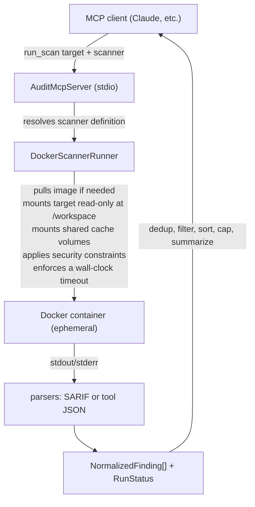

# audit-mcp

An [MCP](https://modelcontextprotocol.io/) server that runs static analysis and security scanners inside isolated Docker containers and returns normalized findings with remediation context.

Point it at any directory and your AI assistant can audit it — without installing a single scanner locally.

It is built to **run anyway**: the server starts without Docker, `mode=all` figures out the languages from what is actually in the directory, every scanner has a wall-clock budget, and a scanner that cannot run says so instead of reporting a clean bill of health.

Point it at a path, or at a repository you have never checked out. Run the scanners in local Docker containers, or as Kubernetes Jobs in a cluster.

## Features

- **95+ scanners** across Rust, Go, Python, Node, IaC/Kubernetes, Java, Ruby, PHP, .NET, C/C++, Kotlin, Elixir, SQL, and Shell — plus a cross-language security layer (semgrep, gitleaks, grype, osv-scanner) that runs on every target
- **Real normalized findings** — a generic SARIF parser plus tool-native JSON parsers turn scanner output into structured findings with rule IDs, severities, file/line locations, remediation, and stable fingerprints you can diff across runs
- **Honest results** — every run reports `clean`, `findings`, `unparsed`, `tool_error`, `timeout`, or `skipped`. "Found nothing" and "could not run" are never confused
- **Fully isolated** — every scanner runs in its own ephemeral Docker container with a read-only workspace mount, `no-new-privileges`, and all Linux capabilities dropped
- **Bounded** — per-scanner timeouts, a container concurrency cap, and severity filtering / result caps so a large repo cannot hang the call or flood your context
- **Persistent cache** — named Docker volumes share downloaded packages and compiled artifacts across runs so repeated scans are fast
- **Remote repositories** — `target` accepts a git URL or `owner/repo`; the server clones it, scans it, and deletes it. Public repositories need no configuration
- **Two execution backends** — local Docker by default, or Kubernetes Jobs when there is no Docker socket to hand out. Both produce identical findings, and a test enforces that
- **MCP-native** — exposes `list_scanners`, `audit_status`, `run_scan`, `explain_finding`, and `suggest_fixes` as structured tools any MCP client can call
- **Content-based language detection** — `mode=all` walks the target directory for manifests and source files, so a polyglot repo gets every relevant scanner

## Requirements

- Rust 1.88+ (build only)
- Docker (running daemon, accessible via the default socket)

## Auth-required scanners

Some scanners require credentials supplied as host environment variables. `audit-mcp` only passes through an allowlisted set per scanner.

- `snyk`, `snyk-java`, `dotnet-snyk`: requires `SNYK_TOKEN` (optionally passes `SNYK_API`, `SNYK_CFG_ORG`)
- `dotnet-sonarscanner`: requires `SONAR_TOKEN` and `SONAR_HOST_URL` (optionally passes `SONAR_PROJECT_KEY`, `SONAR_ORGANIZATION`)

## Installation

```bash
git clone https://github.com/mbround18/audit-mcp
cd audit-mcp
cargo build --release
```

The binary is at `target/release/audit-mcp`. It communicates over stdio, so it is wired up as an MCP server in your client's configuration file.

### Claude Code / Claude Desktop

```json
{
  "mcpServers": {
    "audit": {
      "command": "/path/to/audit-mcp"
    }
  }
}
```

## Tools

### `list_scanners`

Returns the full scanner catalog with names, descriptions, categories, whether each scanner's output is **normalized**, and any credentials it requires. No arguments.

### `audit_status`

Reports whether a Docker daemon is reachable and how much of the catalog produces structured findings. Answers even with no daemon running — call it first when a scan fails. No arguments.

### `run_scan`

| Field              | Type                           | Description                                                        |
| ------------------ | ------------------------------ | ------------------------------------------------------------------ |
| `target`           | `string`                       | Absolute path to a directory (or a single file) to scan            |
| `mode`             | `"single" \| "many" \| "all"`  | How scanners are selected (default: `single`)                      |
| `scanner`          | `string`                       | Scanner name — required when `mode=single`                         |
| `scanners`         | `string[]`                     | Scanner names — required when `mode=many`                          |
| `ref`              | `string`                       | Branch, tag, or commit when `target` is a repository (or inline as `target#ref`) |
| `subdir`           | `string`                       | Scan only this path within the repository                          |
| `min_severity`     | `string`                       | Drop findings below this level (`info`/`low`/`medium`/`high`/`critical`) |
| `max_findings`     | `number`                       | Cap findings returned (default 200; the budget goes to the most severe first) |
| `include_raw_logs` | `boolean`                      | Attach raw stdout/stderr even when parsing succeeded               |
| `timeout_secs`     | `number`                       | Wall-clock ceiling per scanner, overriding its default             |
| `max_parallel`     | `number`                       | Concurrent scanner containers (default 4)                          |

`mode=all` auto-selects scanners by walking the target directory for ecosystem markers. A file target mounts its parent directory and scopes the scanner to that one file.

#### Targets

| Form | Example |
| ---- | ------- |
| Local path | `/home/me/project` |
| HTTPS git URL | `https://github.com/owner/repo` |
| SSH git URL | `git@github.com:owner/repo.git` |
| Shorthand | `owner/repo` (GitHub) |
| With a ref | any of the above plus `#main`, `#v1.2.3`, or `#a1b2c3d` |

An existing local path always wins, so nothing you scan today changes meaning.

The response reports a `workspace` block naming the origin, the normalized source URL, the exact commit scanned, and which credential source was used — the source's *name*, never its value.

#### Run statuses

Every entry in `runs[]` carries a `status`:

| Status       | Meaning                                                                       |
| ------------ | ----------------------------------------------------------------------------- |
| `clean`      | Ran, output parsed, nothing to report                                          |
| `findings`   | Ran and reported at least one finding                                          |
| `unparsed`   | Ran, but no parser exists for its output — raw logs are attached               |
| `tool_error` | Could not run (bad flag, missing tool, unexpected exit code); logs attached     |
| `timeout`    | Exceeded its wall-clock budget and was killed                                  |
| `skipped`    | Deliberately not run (e.g. required credentials absent)                        |

The response also carries a `summary` with a severity rollup, per-status scanner counts, and notes about anything that was deduplicated, filtered, or truncated.

### `explain_finding`

Takes a scanner name and finding ID, returns a plain-language explanation and remediation steps. A finding's `id` is the tool's own rule identifier (`SC2086`, `B602`, `DL3006`), so it can be passed straight through from `run_scan` output.

### `suggest_fixes`

Takes an array of normalized findings, returns minimal fix suggestions.

## Remote repositories

Set none of these and public repositories still clone. Credentials are used in this order, and only ever for the transport they can authenticate:

| Variable(s) | Use |
| ----------- | --- |
| `GITHUB_APP_ID`, `GITHUB_APP_PRIVATE_KEY`, `GITHUB_APP_INSTALLATION_ID` | GitHub App installation token, minted fresh per scan. All three or none |
| `GITHUB_TOKEN` | Token or PAT over HTTPS |
| `SSH_PRIVATE_KEY` + `SSH_KNOWN_HOSTS` | git over SSH. Host key checking is never silently disabled, so both are required |
| _(none)_ | If the `gh` CLI is installed and logged in, its token is borrowed for GitHub targets. Set `AUDIT_USE_GH_CLI=false` to opt out |

Bounds, all overridable: shallow clone (`AUDIT_CLONE_DEPTH=1`), 300 s (`AUDIT_CLONE_TIMEOUT_SECS`), 2 GiB (`AUDIT_CLONE_MAX_BYTES`). A target resolving to a private, loopback, or link-local address is refused unless `AUDIT_ALLOW_PRIVATE_ADDRESSES=true`; `AUDIT_ALLOW_REMOTE_TARGETS=false` disables cloning entirely.

The clone is removed when the scan ends — including when it fails or times out — and workspaces orphaned by a killed process are reaped at startup.

## Kubernetes execution

```bash
cargo build --release --features kubernetes
AUDIT_EXECUTOR=kubernetes AUDIT_K8S_NAMESPACE=audit audit-mcp
```

Each scanner becomes a `batch/v1` Job. Cluster credentials come from the in-cluster ServiceAccount when present, otherwise your kubeconfig. The workspace arrives through a git-clone initContainer writing into an `emptyDir` the scanner mounts read-only — no host path, no PVC, and no Docker socket, which is a stronger posture than the local default.

Because a cluster cannot see your filesystem, this backend needs a **repository** target; a local path is refused with an explanation rather than scanned as an empty directory. Clone credentials are delivered through a Secret, never the Job spec, which is readable by anyone with `get jobs` in the namespace.

Operator settings: `AUDIT_K8S_SERVICE_ACCOUNT`, `AUDIT_K8S_CPU_REQUEST` / `AUDIT_K8S_CPU_LIMIT`, `AUDIT_K8S_MEMORY_REQUEST` / `AUDIT_K8S_MEMORY_LIMIT`, `AUDIT_K8S_NODE_SELECTOR`, `AUDIT_K8S_TOLERATIONS`, `AUDIT_K8S_IMAGE_PULL_SECRETS`, `AUDIT_K8S_JOB_TTL_SECONDS`. See [contracts/configuration.md](specs/001-hosted-execution-modes/contracts/configuration.md).

## Supported languages and scanners

| Language                   | Scanners                                                                                                                                                                                        |
| -------------------------- | ----------------------------------------------------------------------------------------------------------------------------------------------------------------------------------------------- |
| Rust                       | `cargo-audit`, `cargo-clippy`, `cargo-deny`, `cargo-fmt`, `cargo-machete`, `cargo-bloat`, `cargo-tarpaulin`, `cargo-llvm-cov`, `cargo-outdated`, `cargo-mutants`, `cargo-geiger`, `cargo-udeps` |
| Go                         | `govulncheck`, `gosec`, `golangci-lint`, `staticcheck`, `goimports`, `gocyclo`, `nilaway`, `ineffassign`, `go-carpet`, `revive`, `errcheck`                                                     |
| Python                     | `bandit`, `safety`, `ruff`, `black`, `mypy`, `pip-audit`, `vulture`, `flake8`, `isort`, `radon`                                                                                                 |
| Node                       | `knip`, `snyk`, `retire`, `auditjs`, `eslint`, `prettier`, `depcheck`, `license-checker`, `oxlint`, `npm-audit`, plus `lighthouse` and `bundlephobia` (catalog-only, see below)                |
| IaC/K8s                    | `checkov`, `tfsec`, `kube-linter`, `trivy-config`, `hadolint`, `kubesec`, `conftest`, `terrascan`                                                                                               |
| Cross-language (always-on) | `semgrep`, `gitleaks`, `osv-scanner`, `grype`, `bearer`                                                                                                                                         |
| Java                       | `spotbugs`, `pmd`, `checkstyle`, `snyk-java`, `google-java-format`, `dependency-check`                                                                                                          |
| Ruby                       | `brakeman`, `bundler-audit`, `rubocop`, `pronto`, `debride`, `flay`, `flog`, `standardrb`, `license_finder`                                                                                     |
| PHP                        | `phpstan`, `psalm`, `phpcs`, `rector`, `enlightn`                                                                                                                                               |
| .NET                       | `dotnet-format`, `roslyn-analyzers`, `dotnet-sonarscanner`, `dotnet-snyk`, `jb-inspectcode`                                                                                                     |
| C/C++                      | `clang-tidy`, `cppcheck`, `clang-format`, `flawfinder`                                                                                                                                          |
| Shell                      | `shellcheck`                                                                                                                                                                                    |
| Kotlin                     | `detekt`, `ktlint`                                                                                                                                                                              |
| Elixir                     | `credo`, `sobelow`                                                                                                                                                                              |
| SQL                        | `sqlfluff`                                                                                                                                                                                      |

`lighthouse` and `bundlephobia` take a URL or a package name rather than a repository path, so they stay in the catalog for explicit `mode=single` use but are never auto-selected by `mode=all`.

## Normalized vs. raw output

Roughly a third of the catalog emits SARIF or tool-native JSON that `audit-mcp` parses into structured findings; the rest returns raw logs with status `unparsed`. `list_scanners` marks which is which via the `normalized` field, and `audit_status` reports the overall coverage. Adding a parser is the main way to extend the project — see [docs/ARCHITECTURE.md](docs/ARCHITECTURE.md).

## How it works



Cache volumes are named `audit-cargo-home`, `audit-go-mod-cache`, `audit-uv-tools`, etc. — one set per language, shared across all scanners that use the same ecosystem. Per-scanner build artifact volumes (`audit-target-<scanner>`) prevent cross-scanner collisions.

## Development

```bash
# type-check
cargo check

# run tests (fast, no Docker/network required)
cargo test

# run end-to-end tests against real scanner containers (needs Docker + network)
cargo test --test e2e_scan -- --ignored

# verify scanner command templates actually execute in their images
cargo test --test scanner_smoke -- --ignored --nocapture

# clone paths against a real remote, and the secret-leak sentinel
cargo test --test workspace_clone -- --ignored
cargo test --test secret_hygiene -- --ignored

# Docker/Kubernetes parity (needs a cluster and a usable namespace)
cargo test --features kubernetes --test executor_parity -- --ignored

# lint
cargo clippy -- -D warnings

# format check
cargo fmt -- --check

# run the server (reads MCP messages from stdin)
cargo run
```

See [docs/ARCHITECTURE.md](docs/ARCHITECTURE.md) for a deeper walkthrough of the module structure.

## License

[BSD 3-Clause](LICENSE) — Copyright (c) 2025 MBRound18
