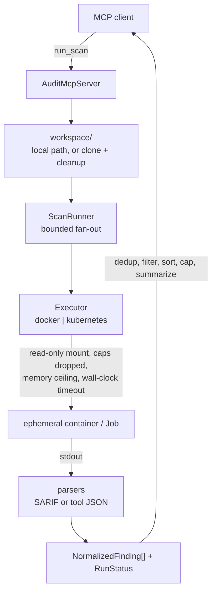

# audit-mcp

[](https://github.com/mbround18/audit-mcp/actions/workflows/paws.yml)
[](LICENSE)

An [MCP](https://modelcontextprotocol.io/) server that runs 95+ static analysis
and security scanners inside isolated containers and returns **normalized
findings** — rule IDs, severities, file and line, remediation — instead of a
wall of tool output.

Point your assistant at a directory, or at a repository nobody has checked out,
and it can audit it without a single scanner installed locally.

```jsonc
// "run_scan" against a repo you don't have on disk
{ "target": "owner/repo#main", "mode": "all", "min_severity": "high" }
```

```jsonc
// what comes back
{
  "workspace": { "origin": "git_https", "resolved_ref": "a1b2c3d…", "credential_source": "gh_cli" },
  "summary": { "total_findings": 14, "by_severity": { "critical": 1, "high": 13 }, … },
  "runs": [{
    "scanner": "semgrep",
    "status": "findings",
    "findings": [{
      "id": "python.lang.security.audit.exec-detected",
      "severity": "high",
      "location": { "path": "app/handler.py", "line": 42 },
      "remediation": "Avoid exec(); use explicit dispatch.",
      "fingerprint": "semgrep:python.lang.security.audit.exec-detected:app/handler.py:42"
    }]
  }]
}
```

---

## Why this one

**A result never lies.** Most scanner wrappers can't tell "found nothing" from
"couldn't run" — a crashed tool and a clean repo look identical. Every run here
reports one of `clean`, `findings`, `unparsed`, `tool_error`, `timeout`, or
`skipped`, and a scanner that produced no report it was asked for is never
called clean.

**Findings are real findings.** A generic SARIF parser plus tool-native JSON
parsers turn output into structured findings with stable fingerprints
(`scanner:rule:path:line`, no run IDs) you can diff across runs and deduplicate
across scanners.

**It runs anyway.** The server starts without Docker. `mode=all` infers
languages from what's actually in the directory, not from the path string.
Every scanner has a wall-clock budget, concurrency is capped, and findings are
severity-sorted and capped so a big repo can't flood your context.

**Isolation is the product.** Read-only workspace, `no-new-privileges`,
capabilities dropped, memory ceiling, per-scanner credential allowlist, and a
redaction pass so a credential can't reach a response field.

---

## Requirements

- **Docker** — a running daemon (or a Kubernetes cluster; see below)
- **git** — only for scanning remote repositories
- **Rust 1.88+** — to build from source

## Install

```bash
git clone https://github.com/mbround18/audit-mcp
cd audit-mcp
cargo build --release
```

The binary lands at `target/release/audit-mcp` and speaks MCP over stdio.

Optional features, both **off by default** so a default build carries none of
their dependencies:

```bash
cargo build --release --features kubernetes   # run scanners as Kubernetes Jobs
cargo build --release --features http         # serve MCP over authenticated HTTP
```

### Wire it into a client

**Claude Code / Claude Desktop** — add to your MCP config:

```json
{
  "mcpServers": {
    "audit": { "command": "/path/to/audit-mcp" }
  }
}
```

Then ask for an audit in plain language: *"scan this repo for security issues"*,
*"audit github.com/owner/repo and show me only the high-severity findings"*.

---

## Tools

| Tool | What it does |
| ---- | ------------ |
| `run_scan` | Run scanners against a path or repository; returns normalized findings and a severity rollup |
| `list_scanners` | The catalog: names, categories, whether output is normalized, credentials required |
| `audit_status` | Whether the execution backend is reachable, what `git` and credentials are available, which transport is active |
| `explain_finding` | Plain-language explanation and remediation for a scanner + rule ID |
| `suggest_fixes` | Minimal fix steps from a set of findings |

### `run_scan`

| Field | Type | Description |
| ----- | ---- | ----------- |
| `target` | `string` | A path, a git URL, or `owner/repo` |
| `mode` | `"single" \| "many" \| "all"` | How scanners are chosen (default `single`) |
| `scanner` / `scanners` | `string` / `string[]` | Required for `single` / `many` |
| `ref` | `string` | Branch, tag, or commit (or inline as `target#ref`) |
| `subdir` | `string` | Scan only this path within the repository |
| `min_severity` | `string` | Drop findings below `info`/`low`/`medium`/`high`/`critical` |
| `max_findings` | `number` | Cap results (default 200); the budget goes to the most severe first |
| `include_raw_logs` | `boolean` | Attach raw stdout/stderr even on success |
| `timeout_secs` | `number` | Per-scanner wall-clock ceiling |
| `max_parallel` | `number` | Concurrent scanner containers (default 4) |

**Targets**

| Form | Example |
| ---- | ------- |
| Local path | `/home/me/project` |
| HTTPS URL | `https://github.com/owner/repo` |
| SSH URL | `git@github.com:owner/repo.git` |
| Shorthand | `owner/repo` |
| With a ref | any of the above + `#main`, `#v1.2.3`, `#a1b2c3d` |

An existing local path always wins, so nothing you scan today changes meaning.

**Run statuses**

| Status | Meaning |
| ------ | ------- |
| `clean` | Ran, output parsed, nothing to report |
| `findings` | Ran and reported at least one finding |
| `unparsed` | Ran, but no parser recognized its output — raw logs attached |
| `tool_error` | Could not run; logs attached |
| `timeout` | Exceeded its budget and was killed |
| `skipped` | Deliberately not run (missing credentials) |

---

## Scanning remote repositories

Public repositories need **no configuration**. For private ones, credentials
are tried in this order and only ever for the transport they can authenticate:

| Variable(s) | Use |
| ----------- | --- |
| `GITHUB_APP_ID`, `GITHUB_APP_PRIVATE_KEY`, `GITHUB_APP_INSTALLATION_ID` | GitHub App installation token, minted per scan. All three or none |
| `GITHUB_TOKEN` | Token or PAT over HTTPS |
| `SSH_PRIVATE_KEY` + `SSH_KNOWN_HOSTS` | git over SSH — host key checking is never silently disabled, so both are required |
| _(nothing configured)_ | If the [`gh` CLI](https://cli.github.com/) is logged in, its token is borrowed for GitHub targets. `AUDIT_USE_GH_CLI=false` opts out |

The response always names the source used (`credential_source`), never the
value. The clone is removed when the scan ends — including on failure and
timeout — and workspaces orphaned by a killed process are reaped at startup.

**Bounds**, all overridable: shallow clone (`AUDIT_CLONE_DEPTH`), 300 s
(`AUDIT_CLONE_TIMEOUT_SECS`), 2 GiB (`AUDIT_CLONE_MAX_BYTES`). A target
resolving to a private, loopback, or link-local address is refused unless
`AUDIT_ALLOW_PRIVATE_ADDRESSES=true`. `AUDIT_ALLOW_REMOTE_TARGETS=false`
disables cloning entirely.

## Running in Kubernetes

For deployments with no Docker socket to hand out — mounting one would give
every scanner image root on the node.

```bash
cargo build --release --features kubernetes
AUDIT_EXECUTOR=kubernetes AUDIT_K8S_NAMESPACE=audit audit-mcp
```

Each scanner becomes a `batch/v1` Job. Cluster credentials come from the
in-cluster ServiceAccount when present, otherwise your kubeconfig. The
workspace arrives via a git-clone initContainer writing into an `emptyDir` the
scanner mounts read-only — no host path, no PVC, no socket.

Because a cluster can't see your filesystem, this backend needs a **repository**
target; a local path is refused with an explanation rather than scanned as an
empty directory. Clone credentials are delivered through a Secret, never the Job
spec (which anyone with `get jobs` can read).

Operator knobs: `AUDIT_K8S_SERVICE_ACCOUNT`, `AUDIT_K8S_CPU_REQUEST`/`_LIMIT`,
`AUDIT_K8S_MEMORY_REQUEST`/`_LIMIT`, `AUDIT_K8S_NODE_SELECTOR`,
`AUDIT_K8S_TOLERATIONS`, `AUDIT_K8S_IMAGE_PULL_SECRETS`,
`AUDIT_K8S_JOB_TTL_SECONDS`.

## Hosted HTTP transport (preview)

```bash
cargo build --release --features http
AUDIT_TRANSPORT=http \
AUDIT_RESOURCE_URL=https://audit.example.com/mcp \
AUDIT_OAUTH_ISSUER=https://idp.example.com \
audit-mcp
```

Serves MCP over streamable HTTP with the server acting as an OAuth 2.1 Resource
Server: RFC 9728 metadata at `/.well-known/oauth-protected-resource`, a
`WWW-Authenticate` challenge, and JWT validation against your provider's JWKS
including **audience** — a token minted by the same issuer for another service
is rejected. There is no unauthenticated HTTP mode.

**Authentication is not authorization.** A token proves who you are; it does
not entitle you to everything this server can reach. To scan a repository on
this transport you also supply your *own* GitHub credential — a GitHub App
installation token or a PAT — in the `X-Audit-Github-Token` header:

```bash
curl -X POST https://audit.example.com/mcp \
  -H "Authorization: Bearer $OIDC_TOKEN" \
  -H "X-Audit-Github-Token: $GITHUB_TOKEN" \
  ...
```

The server confirms *that* credential can read the repository before anything
is cloned, and then clones with it — so what you can scan is exactly what you
could already read. A server-held credential is never substituted on your
behalf, which is what stops this server becoming a confused deputy. A refusal
never reveals whether the repository exists.

A header rather than a tool argument, deliberately: a token in a tool argument
would flow through the model's context, where it would be logged, summarized,
and quite possibly repeated back. Local paths need no forge credential.

Full configuration reference:
[`specs/001-hosted-execution-modes/contracts/configuration.md`](specs/001-hosted-execution-modes/contracts/configuration.md).

---

## Scanners

| Language | Scanners |
| -------- | -------- |
| Rust | `cargo-audit`, `cargo-clippy`, `cargo-deny`, `cargo-fmt`, `cargo-machete`, `cargo-bloat`, `cargo-tarpaulin`, `cargo-llvm-cov`, `cargo-outdated`, `cargo-mutants`, `cargo-geiger`, `cargo-udeps` |
| Go | `govulncheck`, `gosec`, `golangci-lint`, `staticcheck`, `goimports`, `gocyclo`, `nilaway`, `ineffassign`, `go-carpet`, `revive`, `errcheck` |
| Python | `bandit`, `safety`, `ruff`, `black`, `mypy`, `pip-audit`, `vulture`, `flake8`, `isort`, `radon` |
| Node | `knip`, `snyk`, `retire`, `auditjs`, `eslint`, `prettier`, `depcheck`, `license-checker`, `oxlint`, `npm-audit` |
| IaC / K8s | `checkov`, `tfsec`, `kube-linter`, `trivy-config`, `hadolint`, `kubesec`, `conftest`, `terrascan` |
| Cross-language | `semgrep`, `gitleaks`, `osv-scanner`, `grype`, `bearer` |
| Java | `spotbugs`, `pmd`, `checkstyle`, `snyk-java`, `google-java-format`, `dependency-check` |
| Ruby | `brakeman`, `bundler-audit`, `rubocop`, `pronto`, `debride`, `flay`, `flog`, `standardrb`, `license_finder` |
| PHP | `phpstan`, `psalm`, `phpcs`, `rector`, `enlightn` |
| .NET | `dotnet-format`, `roslyn-analyzers`, `dotnet-sonarscanner`, `dotnet-snyk`, `jb-inspectcode` |
| C/C++ | `clang-tidy`, `cppcheck`, `clang-format`, `flawfinder` |
| Shell / Kotlin / Elixir / SQL | `shellcheck` · `detekt`, `ktlint` · `credo`, `sobelow` · `sqlfluff` |

Roughly a third emit SARIF or tool-native JSON that gets parsed into structured
findings; the rest return raw logs with status `unparsed`. `list_scanners`
marks which is which. See [docs/SCANNERS.md](docs/SCANNERS.md).

`lighthouse` and `bundlephobia` are catalog-only — they take a URL or package
name, not a repository path, so `mode=all` never selects them.

### Auth-required scanners

`snyk`, `snyk-java`, `dotnet-snyk` need `SNYK_TOKEN`. `dotnet-sonarscanner`
needs `SONAR_TOKEN` and `SONAR_HOST_URL`. Without them those scanners are
`skipped` with a reason — never a failure.

---

## How it works



Named Docker volumes cache packages and compiled artifacts across runs, so
repeat scans are fast. See [docs/ARCHITECTURE.md](docs/ARCHITECTURE.md) and
[docs/CACHE.md](docs/CACHE.md).

## Documentation

| Document | Contents |
| -------- | -------- |
| [docs/ARCHITECTURE.md](docs/ARCHITECTURE.md) | Module structure, the executor seam, why status lives where it does |
| [docs/SCANNERS.md](docs/SCANNERS.md) | Every scanner, base images, exit codes, normalization |
| [docs/SECURITY.md](docs/SECURITY.md) | Isolation model and threat considerations |
| [docs/CACHE.md](docs/CACHE.md) | Cache volume strategy |
| [docs/CONTRIBUTING.md](docs/CONTRIBUTING.md) | Building, testing, and adding scanners |

## For AI agents

[`llms.txt`](llms.txt) describes the tool surface, how to read a `status`, and
the guarantees worth relying on — written to be pasted into a context window or
fetched directly.

## Contributing

See [docs/CONTRIBUTING.md](docs/CONTRIBUTING.md). CI runs on
[paws](https://github.com/mbround18/paws), so `paws ci --toolchain rust`
reproduces it exactly on your machine. `.mcp.json` registers both `paws` and
`audit-mcp` itself, so an assistant working in this repo can audit it.

A container image is available for the Kubernetes deployment:

```bash
docker build -t audit-mcp .        # or: paws docker --image ghcr.io/you/audit-mcp
```

## License

[MIT](LICENSE) — Copyright (c) 2025 MBRound18
