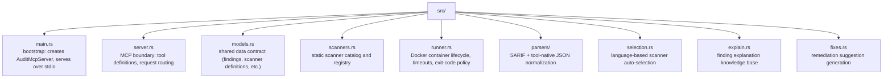
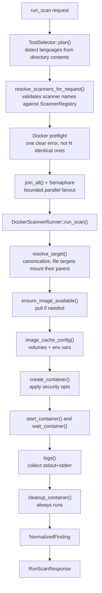

# Architecture

## Overview

`audit-mcp` is a single Rust binary that speaks the [Model Context Protocol](https://modelcontextprotocol.io/) over stdio. It exposes five tools to any MCP-compatible client and executes all scanner work inside ephemeral Docker containers.

`src/lib.rs` re-exports every module as the `audit_mcp` library crate; `src/main.rs` is a thin binary entry point on top of it. The library target exists so `tests/e2e_scan.rs` can drive `AuditMcpServer`'s real tool methods directly instead of talking to a spawned process over stdio.

## Module responsibilities

### `main.rs`

Process entry point only. Creates an `AuditMcpServer`, wraps it in the RMCP stdio transport, and blocks until the client disconnects.

### `server.rs`

The MCP surface. Defines tool request/response DTOs and wires them to handler methods via the `#[tool_router]` and `#[tool_handler]` RMCP macros. Nothing in this file touches Docker or filesystem.

Tools:

- `list_scanners` — delegates to `ScannerRegistry::list_summaries`; reports which scanners are normalized and which need credentials
- `audit_status` — reports Docker reachability and catalog normalization coverage; answers even with no daemon running
- `run_scan` — validates the request, resolves the scanner set, preflights Docker once, then fans out under a concurrency semaphore
- `explain_finding` — delegates to `FindingExplainer`
- `suggest_fixes` — delegates to `FixEngine`

`shape_results` (also in this file) owns everything that shapes the response: per-scanner fingerprint dedup, `min_severity` filtering, severity-descending sort, a global `max_findings` cap that spends its budget on the most severe findings first, and the `ScanSummary` rollup. It takes plain data and is fully unit-tested without Docker.

### `models.rs`

The shared data contract. All cross-module payload types live here:

- `ScannerDefinition` — name, image, command template, optional install script, `success_exit_codes`, `output_format`, `timeout_secs`
- `RunStatus` — `clean` / `findings` / `unparsed` / `tool_error` / `timeout` / `skipped`; the distinction between "found nothing" and "could not run"
- `Severity` — ordered ladder (`unknown` < `info` < `low` < `medium` < `high` < `critical`) with parsing for the synonyms different tools use
- `ScanSummary` — severity rollup and per-status scanner counts
- `NormalizedFinding` — scanner-agnostic finding shape with severity, location, fingerprint, and raw output
- `ScanExecution` — execution metadata attached to a completed scan
- `ToolSelectionPlan` — which scanners were chosen and why
- `RunScanResponse` — full response envelope

Changes to the finding shape should be made here first.

### `scanners.rs`

A static in-memory catalog of all supported scanners. `ScannerRegistry` is built at startup from hardcoded `ScannerDefinition` entries and validates that every entry has a non-empty image and command template before the server begins accepting requests.

Entries are written with a fluent `Builder` so each states only what differs from the defaults (exit codes `[0]`, text output, the default timeout): `python("ruff", …).sarif().exits(&[0, 1]).build()`.

`validate_container_guards` runs at startup and rejects a catalog that has an empty image, an empty command template, no success exit codes, or a `Json` output format with no matching parser in `parsers::tools` — so a structured format can never silently degrade to raw logs.

### `runner.rs`

The Docker layer. `DockerScannerRunner` owns a `bollard::Docker` client and is responsible for:

1. Connecting to the daemon **lazily** (`tokio::sync::OnceCell`), so the MCP server starts with no Docker present and picks up a daemon that appears later; failures are not cached
2. Skipping (not failing) a scanner whose required credentials are absent
3. Resolving the target — a directory is mounted as-is, a **file** target mounts its parent and scopes the command to that one file
4. Pulling the scanner image if absent
5. Creating, starting, and waiting for the container under a wall-clock timeout
6. Reading logs and handing the **full** buffer to `parsers`
7. Cleaning up the container regardless of outcome

**Exit-code policy.** Each scanner declares `success_exit_codes`. An exit outside that set is a `tool_error` carrying the logs — unless the tool nonetheless produced parseable findings, in which case the run is trusted. That keeps an unusual exit code from discarding a useful scan while still surfacing genuine crashes.

**Timeouts.** The wait is wrapped in `tokio::time::timeout`. On expiry the container is `SIGKILL`ed, its logs are collected (so partial work is still visible), and the run is reported as `timeout` — never as a hang.

**Entrypoint.** Every container is created with `entrypoint: []`. Most scanner images set the tool itself as the ENTRYPOINT, which would otherwise swallow the command template — `gitleaks` plus `["gitleaks","detect"]` becomes `gitleaks gitleaks detect`, and `["sh","-c",…]` is passed to the tool as arguments. Clearing it means a command template always means exactly what it says, on every image.

**Security constraints applied to every container:**

| Constraint      | Value                    | Reason                         |
| --------------- | ------------------------ | ------------------------------ |
| Workspace mount | `:ro`                    | Scanner cannot modify source   |
| `SecurityOpt`   | `no-new-privileges:true` | Blocks setuid/sudo escalation  |
| `CapDrop`       | `ALL`                    | Removes all Linux capabilities |
| `Memory`        | 4 GB                     | Bounds compiler memory usage   |
| Concurrency     | 4 containers (default)   | 4 GB each; unbounded fan-out OOMs the host |

Because all capabilities are dropped, root inside the container has no `CAP_DAC_OVERRIDE` and cannot write to apt's `_apt`-owned cache directories. The `APT` install prefix in `scanners.rs` relocates apt's archive and list directories under `/tmp` instead of relaxing the sandbox.

**Cache volumes** are named Docker volumes mounted at `/cache/*` inside the container. Environment variables (`CARGO_HOME`, `UV_CACHE_DIR`, `GEM_HOME`, etc.) redirect each ecosystem's tooling to those paths. This means package downloads and compiled artifacts persist across runs without any host filesystem exposure.

Per-scanner target volumes (`audit-target-<scanner>`) prevent concurrent scanners from writing conflicting build artifacts into a shared directory.

**Bollard quirk:** Docker's wait API surfaces non-zero container exits as `Err(DockerContainerWaitError { code, .. })` rather than `Ok(WaitContainerResponse { status_code })`. The runner intercepts this variant and converts it to a synthetic response so the exit code is handled uniformly.

### `selection.rs`

`ToolSelector` maps a target to a set of scanner names via per-language profiles. Used only when `mode=all` is requested. The selected set is intersected with the live registry so deleted or renamed scanners never appear in results.

Detection reads the target's **contents**, not its path string:

- **Directory** — `detect_languages` walks it breadth-first, bounded to depth 4 and 20 000 entries, skipping dependency and build directories (`node_modules`, `target`, `vendor`, `.venv`, …). Every manifest (`Cargo.toml`, `go.mod`, `package.json`, …) and source extension it finds contributes a language, so a polyglot repository selects every relevant profile at once. The files that drove the decision are returned as `evidence`.
- **File** — classified by its own name.
- **Neither** (a path not present on this host) — falls back to the legacy `infer_language` path-string heuristic, and says so in the plan's `rationale`.

The `security` profile is cross-language and is always unioned in. `lighthouse` and `bundlephobia` are deliberately excluded from auto-selection: they take a URL or package name, not a repository path.

### `parsers/`

The normalization layer, in preference order:

- `parsers/sarif.rs` — a generic SARIF 2.1.0 parser. This is the highest-leverage code in the project: one implementation normalizes every scanner that can emit SARIF (semgrep, gitleaks, hadolint, gosec, golangci-lint, ruff, tfsec, terrascan, bearer, psalm, flawfinder, detekt, ktlint, …), with real rule IDs, help URIs, and severities. Severity resolves from `security-severity` (CVSS), then a plain `properties.severity` word, then the SARIF `level`. Suppressed results are dropped.
- `parsers/tools.rs` — tool-native JSON for scanners with no SARIF support (bandit, shellcheck, grype, osv-scanner, cargo-clippy, cargo-audit, npm-audit, eslint, rubocop, staticcheck, pip-audit, kube-linter, phpstan, checkov, trivy).
- `parsers/json.rs` — extraction helpers. Scanner containers interleave banners and progress logs with their report, so `extract_payload` finds the largest parseable JSON document in a noisy stream and `extract_ndjson` handles line-delimited output.

Findings get a **stable fingerprint** (`scanner:rule:path:line`) that contains no run ID, so results can be diffed across runs, and `id` is the tool's own rule identifier so it can be passed straight to `explain_finding`.

### `explain.rs` / `fixes.rs`

Knowledge-base modules that return contextual explanations and fix suggestions given a scanner name and finding. Currently scaffolded — extend by adding scanner-specific entries.

## Data flow

## Adding a new scanner

1. Add an entry in `scanners.rs` using the appropriate language builder.
2. Prefer a command that emits **SARIF** (`.sarif()`) — it needs no new parser. Otherwise emit tool-native JSON, add a parser to `parsers/tools.rs`, list the name in `SUPPORTED`, and mark the entry `.json()`. If neither is possible, leave it as text; runs will report `unparsed` with raw logs attached.
3. Declare `.exits(&[…])` with every exit code that means "ran correctly". Most linters exit 1 simply because they found something. Never wrap the command in `|| true` — that is the bug this design exists to prevent, and a unit test rejects it.
4. Never use an in-place write flag (`-w`, `-i`, `--write`, `--fix`): the workspace is mounted read-only. Use the tool's check/dry-run mode. A unit test rejects these too.
5. If the tool is not pre-installed in the base image, set `.install(…)`. For Debian/Ubuntu images use the `APT` prefix constant.
6. Add the scanner name to the relevant `LanguageToolProfile` in `selection.rs` so `mode=all` can discover it.
7. Verify `cargo test` passes, then run the scanner for real: `cargo test --test scanner_smoke -- --ignored --nocapture`. A command template that no image can execute is invisible to the unit tests.

## Adding a new language

1. Add a language builder function in `scanners.rs` (e.g. `swift_scanner`).
2. Add entries for all scanners in that ecosystem.
3. Add a `LanguageToolProfile` in `selection.rs`.
4. Extend `image_cache_config` in `runner.rs` to cover the new image pattern and redirect its cache directories to named volumes.
5. Add the ecosystem's manifest names to `MANIFESTS` and its file extensions to `EXTENSIONS` in `selection.rs` (and, for the not-on-disk fallback path, `infer_language`).

## Testing

Three layers:

- **Unit tests** — `#[cfg(test)]` modules inline in `models.rs`, `parsers/*`, `runner.rs`, `scanners.rs`, `selection.rs`, and `server.rs`. No Docker required; part of the default `cargo test` run. The parser tests pin real tool output shapes, and the registry tests enforce the catalog invariants above.
- **End-to-end tests** — `tests/e2e_scan.rs`. Runs real scanner containers via `DockerScannerRunner` through the full `AuditMcpServer` tool surface (`run_scan`, `list_scanners`, `explain_finding`) against fixtures in `tests/fixtures/`. Each Docker-dependent test is `#[ignore]`d and self-skips (with a message) if no daemon is reachable, so `cargo test` alone stays fast and hermetic. Run explicitly with `cargo test --test e2e_scan -- --ignored` whenever a change touches `runner.rs`, a scanner's `command_template`, or `image_cache_config`.

- **Scanner smoke tests** — `tests/scanner_smoke.rs`. Runs every scanner that declares structured output against a matching fixture and asserts it does not come back as `tool_error`, `timeout`, or `unparsed`. Split into `smoke_fast_tier` (small images) and `smoke_slow_tier` (Go/Rust, which compile first). This is the only layer that catches a command template no image can execute — a swallowed ENTRYPOINT, a renamed flag, a tool missing from the base image. Run it after any change to a `command_template`, an image, or an install script.

When adding a new e2e case, assert on **normalized findings** — rule ID, severity, file, line — not on substrings of raw logs. Log-grepping assertions pass even when normalization is broken, which is precisely the failure this suite exists to catch.
